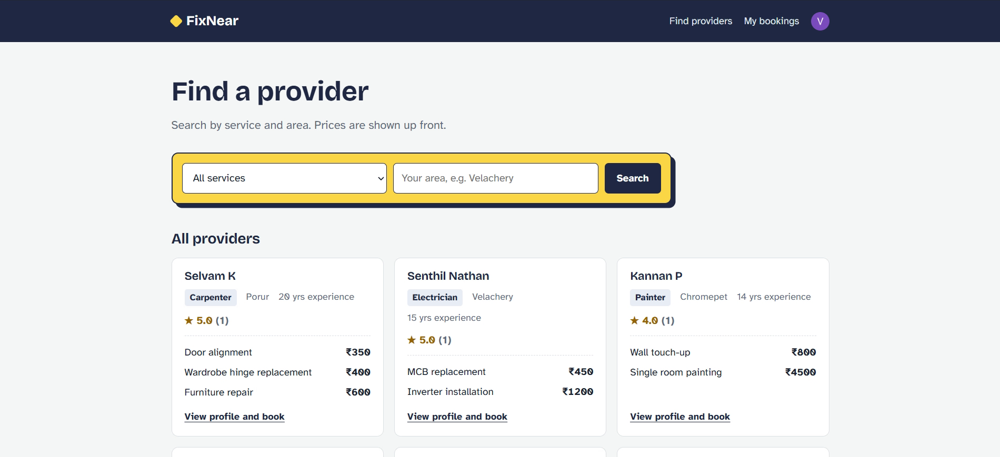
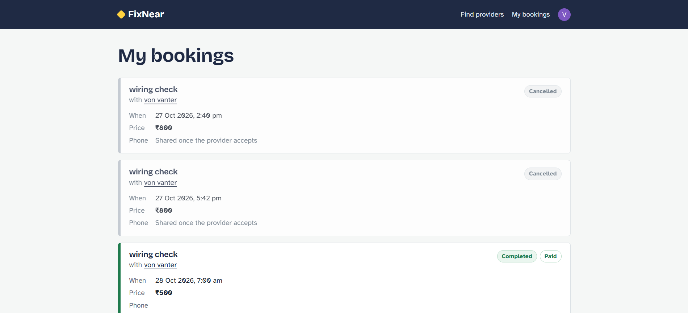
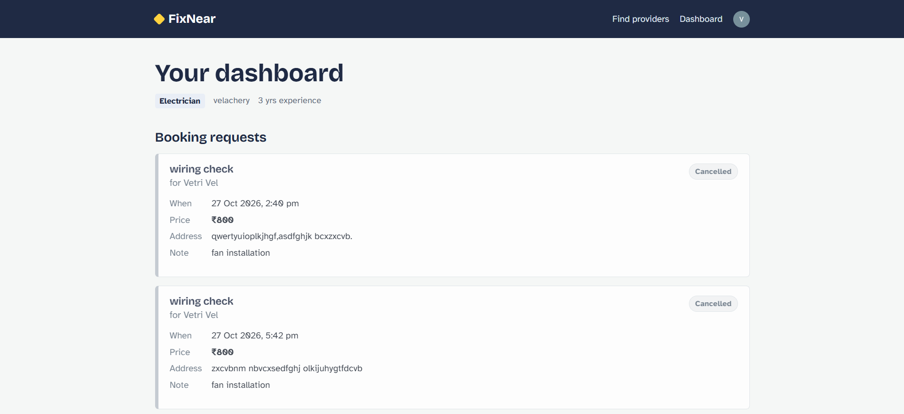

# FixNear

A local services booking platform. Customers find electricians, plumbers, AC technicians and other providers in their area, compare prices, and send booking requests. Providers manage their services and accept or decline requests from a dashboard.

**Live demo:** https://fixnear-henna.vercel.app

> The providers, customers and reviews you see are demo data created by a seed script. Sign up with any email or Google account to try it as a customer or a provider.


## Features

**Customers**
- Search providers by service type and area (case-insensitive, partial match)
- See each provider's experience, services, prices and reviews
- Send a booking request with date, time, address and a note
- Track bookings: waiting, accepted, completed or cancelled
- Cancel a request before it's accepted
- Review a provider after a completed job (one review per booking)

**Providers**
- Set up a profile (service type, area, experience, phone)
- Add and remove services with their own prices
- Accept or decline requests, mark jobs completed and paid

## Tech stack

| Area | Tools |
|---|---|
| Framework | Next.js 16 (App Router, Server Components, Server Actions) |
| Database | PostgreSQL on Neon (Singapore region) |
| ORM | Prisma 7 with the `@prisma/adapter-pg` driver adapter |
| Auth | Clerk (email and Google sign-in) |
| Styling | Plain CSS with custom properties, no UI library |
| Hosting | Vercel |

## Design decisions

**Price snapshot on bookings.** A booking stores `priceAtBooking`, copied from the service when the request is made. If a provider later changes their price, existing bookings keep the amount the customer agreed to. The server always reads the price from the database, never from the form.

**Booking status as a state machine.** Allowed transitions are defined per role in one config object (`lib/booking-rules.js`):

```
PENDING ──accept──▶ ACCEPTED ──complete──▶ COMPLETED ──mark paid──▶ PAID
   │
   └── reject (provider) / cancel (customer) ──▶ CANCELLED
```

Status updates use a conditional write (`WHERE id = ? AND owner = ? AND status IN (allowed)`), so the check and the update happen atomically. Two people acting on the same booking at the same moment can't produce an invalid state.

**Ownership checks on every write.** Every update and delete is scoped to the signed-in user (for example, a provider can only delete services where `providerId` is their own). Changing an ID in the browser can't modify someone else's data.

**Trustworthy reviews.** A review belongs to a booking, not directly to a provider, and `bookingId` is unique. Only the customer of a completed booking can review it, once. Duplicate submissions are rejected by the database's unique constraint (Prisma error `P2002`) and shown as a friendly message.

**Privacy.** A provider's phone number is rendered only after they accept a booking. Because pages are Server Components, the number is never sent to the browser before that.

**Search state in the URL.** Filters live in query parameters (`/providers?category=Plumber&area=velachery`), so results can be shared, bookmarked and rendered on the server.

**No N+1 queries.** Ratings for the provider list are fetched in a single query and grouped in code, instead of one query per provider.

## Data model

```
User ──1:1── ProviderProfile ──1:N── Service
 │                 │                    │
 └──1:N── Booking ─┴────────────────────┘
             │
             └──1:1── Review
```

Enums: `Role` (CUSTOMER, PROVIDER), `BookingStatus` (PENDING, ACCEPTED, COMPLETED, CANCELLED), `PaymentStatus` (UNPAID, PAID). Full schema: [`prisma/schema.prisma`](prisma/schema.prisma).

Clerk handles authentication; the app's own `User` table links to it through a unique `clerkId`. No passwords are stored in the app database.

## Screenshots



| My bookings (customer) | Dashboard (provider) |
|---|---|
|  |  |

## Running locally

**Requirements:** Node.js 20 or newer, a PostgreSQL database (a free Neon project works), and a Clerk application.

```bash
git clone https://github.com/susil-jayakumar/fixnear.git
cd fixnear
npm install            # also runs `prisma generate`
cp .env.example .env   # then fill in your own values
npx prisma migrate dev # creates the tables
npx tsx prisma/seed.js # optional: adds demo providers and reviews
npm run dev
```

Open http://localhost:3000.

### Environment variables

| Name | Purpose |
|---|---|
| `DATABASE_URL` | Direct Postgres connection, used for migrations and seeding |
| `DATABASE_URL_POOLED` | Pooled connection, used by the app at runtime |
| `NEXT_PUBLIC_CLERK_PUBLISHABLE_KEY` | Clerk publishable key (safe to expose) |
| `CLERK_SECRET_KEY` | Clerk secret key (server only) |

## Project structure

```
app/
  page.js                 Landing page
  providers/              Search (page.js) and public provider pages ([id])
  book/[serviceId]/       Booking form and its server action
  bookings/               Customer bookings, status and review actions
  provider/               Provider dashboard, services, profile setup
  onboarding/             Role selection after first sign-in
components/               SiteHeader, StatusBadge
lib/                      Prisma client, current user helper, rules, formatting
prisma/                   Schema, migrations, seed script
proxy.js                  Clerk middleware and protected routes
```

## Known limitations

- Uses Clerk's development instance; production keys need a custom domain.
- Payment is tracked manually by the provider ("Mark as paid"); there's no payment gateway.
- Addresses are checked for length only, not verified.
- Providers can't edit a service yet, only remove and re-add it.

## Author

Susil Kumar J · [GitHub](https://github.com/susil-jayakumar) · [Portfolio](https://susil-jayakumar.github.io)
